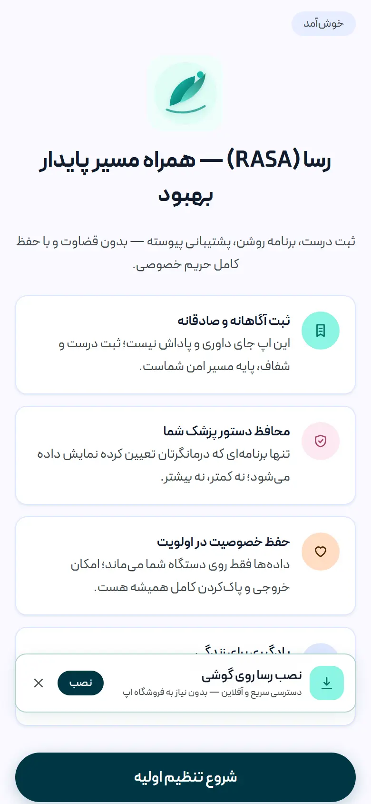
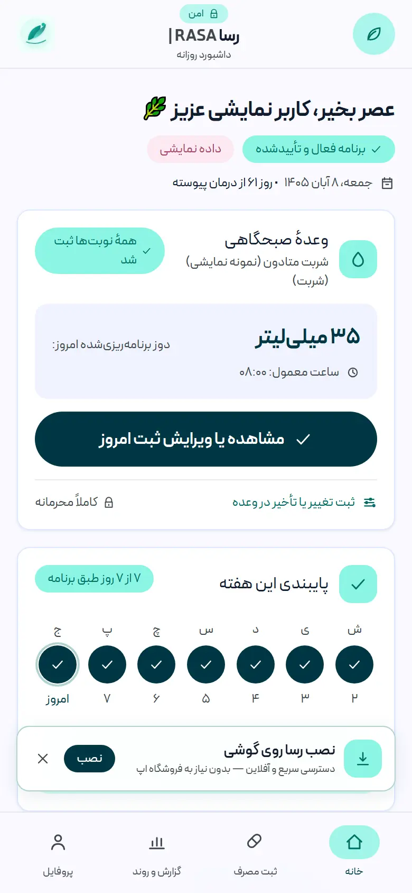
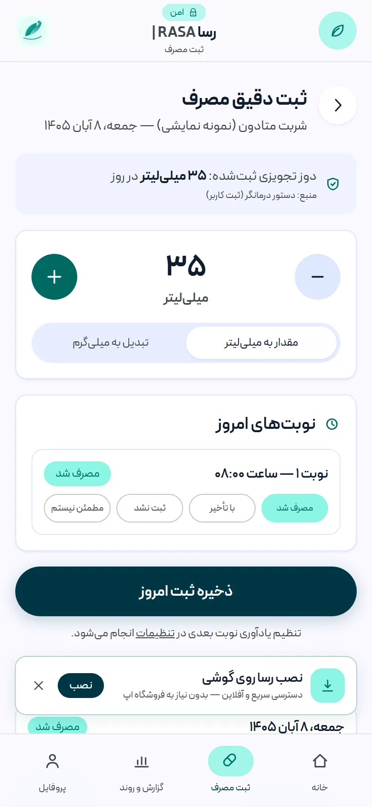
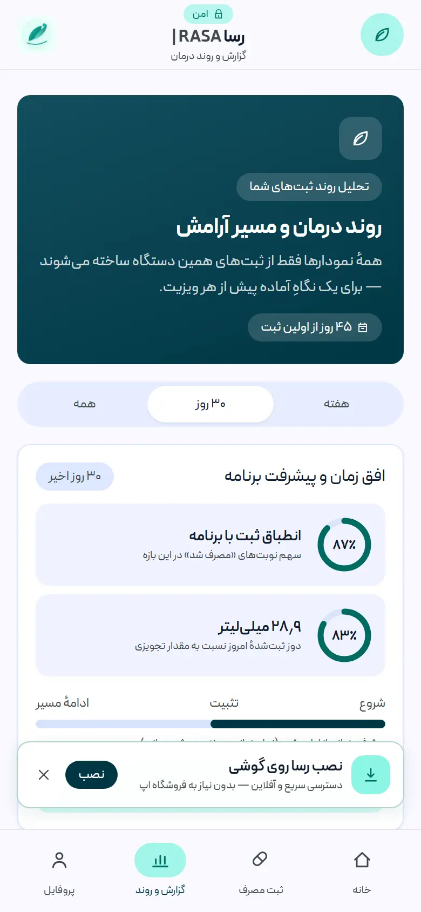
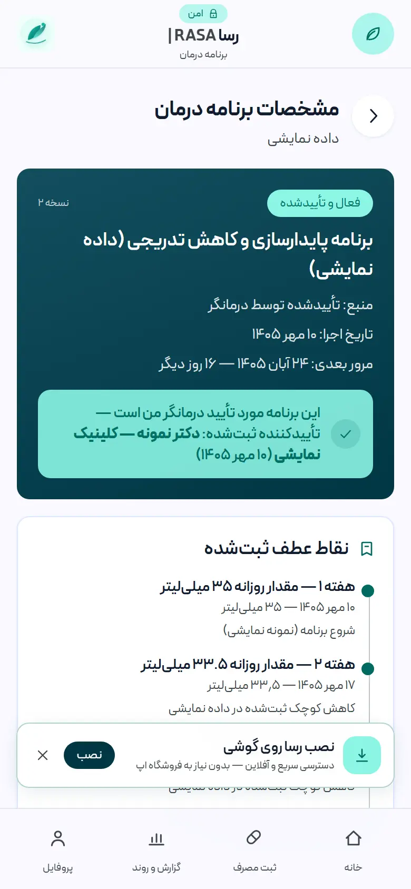
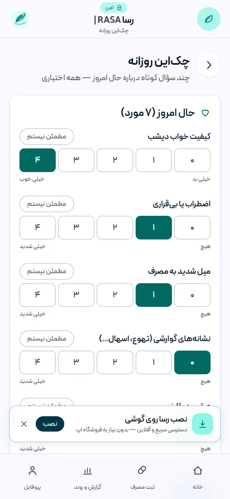
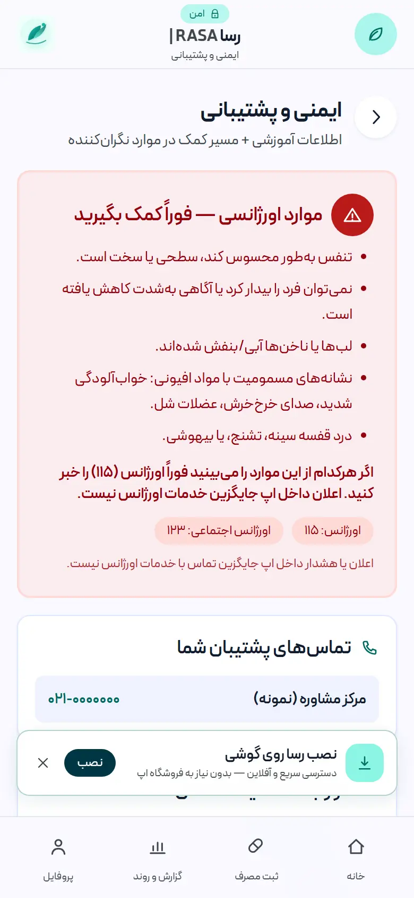
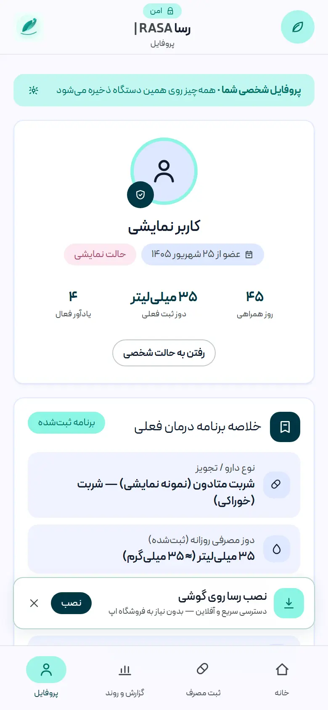

<div dir="rtl">

# رَسا | RASA — نسخهٔ ۱٫۰٫۰ (نخستین انتشار عمومی)

**رسا** یک اپلیکیشن وب فارسی، راست‌به‌چپ و نصب‌پذیر (PWA) برای افراد تحت **درمان با متادون** است: ثبت مصرف روزانه، چک‌این حال جسمی و روحی، برنامهٔ درمان نسخه‌بندی‌شده، گزارش و نمودار روند در **تقویم شمسی**، و راهنمای ایمنِ بی‌طرف — بدون حساب کاربری، بدون تبلیغات، و با ذخیرهٔ کامل داده‌ها فقط روی دستگاه کاربر.

> ⚕️ **رسا ثبت‌کننده است، نه تجویزکننده.** هیچ‌گاه دوز پیشنهاد نمی‌دهد، برنامهٔ کاهش (taper) نمی‌سازد، دوز جبرانی توصیه نمی‌کند و تشخیص نمی‌دهد. تمام تصمیم‌های درمانی فقط با درمانگر شماست.

---

## 🧭 گردش کار اپ (نحوهٔ استفاده)

### ۱) ورود — بدون ثبت‌نام
اپ را باز می‌کنید؛ صفحهٔ «خوش‌آمد» با پذیرش صریح مرزهای درمانی شروع می‌شود. لازم نیست هیچ اطلاعاتی بدهید؛ یا «شروع تنظیم اولیه» را می‌زنید، یا فقط برای دیدن امکانات، **«داده نمایشی»** (شربت یا قرص) را انتخاب می‌کنید. حالت نمایشی با دادهٔ مصنوعی، جدا از دادهٔ واقعی شما و همیشه با نشان «دمو» کار می‌کند.

### ۲) تنظیم اولیه — پروفایل دارو طبق بسته
- نوع دارو: **قرص** یا **شربت (خوراکی)**
- نام دقیق روی بسته + قدرت هر قرص (mg) یا غلظت (mg/mL) — اپ هیچ عددی را «حدس» نمی‌زند
- **مقدار تجویزی روزانه طبق دستور درمانگر** و ساعت‌های مصرف
- نام مستعار و هدف شخصی (هر دو اختیاری؛ هدف فقط یادآور خودتان است، نه دستور درمان)

### ۳) برنامهٔ درمان — نسخه‌بندی‌شده با تأیید صریح
عنوان و منبع برنامه (تأیید درمانگر / خودثبت / رکورد واردشده)، نام تأییدکننده به‌عنوان متن مستندسازی، تاریخ اجرا و **تاریخ مرور بعدی**. برنامه فقط با وضعیت «تأییدشده» به‌عنوان مرجع نمایش داده می‌شود؛ تغییر وضعیت‌ها با جریانِ حالت محدود و ثبت‌شده در تاریخچهٔ برنامه است. اگر «مرور بعدی» بگذرد، فقط **هشدار نمایشی** «مرور برنامه گذشته است» می‌بینید — اپ هرگز برنامه را خودکار جلو نمی‌برد و هیچ taper نمی‌سازد.

### ۴) ثبت مصرف روزانه — خانهٔ اصلی
کارت «وعدهٔ امروز» دوز برنامه‌ریزی‌شده و ساعت معمول را نشان می‌دهد؛ با یک لمس وارد صفحهٔ ثبت مصرف می‌شوید:
- مقدار را با دکمه‌های ± دقیق تنظیم می‌کنید (میلی‌لیتر یا تعداد قرص؛ تبدیل mL↔mg فقط با عدد روی بسته، با BigInt)
- هر نوبت یکی از چهار وضعیت را می‌گیرد: **مصرف شد / با تأخیر / نامطمئن / ثبت نشد**
- اگر نوبتی «ثبت نشد» یا «نامطمئن» بماند، پیام آرام و بی‌قضاوت + راهنمای ایمن نمایش داده می‌شود (هرگز دوز جبرانی توصیه نمی‌شود)
- تاریخ‌ها با **انتخابگر شمسی**؛ هیچ تقویم میلادی در رابط نیست

### ۵) چک‌این روزانه — یک دقیقه، همهٔ موارد اختیاری
هفت سنجهٔ کوتاه: کیفیت خواب، اضطراب، میل شدید به مصرف، نشانه‌های گوارشی، عرق‌سرد/لرز، درد عضلانی و حال عمومی — با گزینهٔ «مطمئن نیستم». نتیجه هیچ «امتیاز تشخیصی» نیست؛ فقط برای گفتگوی بهتر با درمانگر.

### ۶) گزارش و روند — برای ویزیت
بازهٔ هفته/۳۰ روز/همه، تیک‌های پایبندی، میانگین مصرف روزانه و درصدها، **نمودار SVG با محور شمسی**، تحلیل علامت‌های جسمی/روحی، و پرچم‌های ایمن فقط-نمایشی (مثل «اختلاف ثبت با برنامه» برای گفتگو با درمانگر). خروجی **CSV** و نسخهٔ **چاپی** برای بردن به ویزیت.

### ۷) پشتیبانی و ایمنی
راهنمای «نوبت فراموش‌شده»، معیارهای اورژانس و **تماس ۱۱۵** همیشه در دسترس و برجسته؛ پیام‌ها بی‌طرف و بدون سرزنش.

### ۸) پروفایل، یادآور و مالکیت داده
ویرایش اطلاعات درمان، تم‌های پشتیبان، یادآورهای دقیق (دارو، چک‌این، مرور برنامه — بدون نام دارو روی قفل صفحه)، **خروجی کامل JSON**، و «پاک‌کردن همهٔ داده‌های این حالت» با تأیید دومرحله‌ای.

### ۹) نصب روی گوشی (PWA)
اندروید/دسکتاپ: بنر «نصب رسا» یا آیکون نوار آدرس. آیفون: «افزودن به صفحهٔ اصلی» با راهنمای داخل اپ. میان‌برهای «ثبت دارو» و «چک‌این» پس از نصب. پوستهٔ آفلاین با سرویس‌ورکر `rasa-shell-v3`.

---

## 🖼 تصاویر (از محیط واقعی اپ، حالت نمایشی)

| | |
|---|---|
|  |  |
| *خوش‌آمد — بدون ثبت‌نام* | *داشبورد — وعدهٔ امروز و پایبندی هفته* |
|  |  |
| *ثبت دقیق مصرف با وضعیت هر نوبت* | *گزارش و روند با محور شمسی* |
|  |  |
| *برنامهٔ درمان — تأیید صریح و مرور* | *چک‌این — هفت سنجهٔ اختیاری* |
|  |  |
| *ایمنی — راهنما و تماس ۱۱۵* | *پروفایل — خروجی و پاک‌سازی داده* |

اسکرین‌شات‌های کامل (نمای پیوستهٔ صفحه): [`docs/screenshots/`](docs/screenshots/)

---

## 🛡 مرزهای ایمنی بالینی (چیزی که این نسخه هرگز انجام نمی‌دهد)

- ساخت یا خودکارکردن هرگونه برنامهٔ کاهش دوز (taper)
- توصیهٔ دوز، دوز جبرانی، یا «جبران نوبت جامانده»
- تبدیل واحدها بدون عدد صریح روی بسته؛ بدون غلظت، mL→mg انجام نمی‌شود
- نمایش برنامهٔ درمان بدون تأیید ثبت‌شده؛ پیشروی خودکار برنامه
- تشخیص، امتیازدهی بالینی، یا قضاوت دربارهٔ کاربر

جزئیات: [`docs/clinical-safety-boundaries.md`](docs/clinical-safety-boundaries.md) · منابع: [`docs/clinical-evidence.md`](docs/clinical-evidence.md) (WHO 2025، CMAJ 2024، اجماع BAP؛ یادداشت دسترسی SAMHSA TIP 63)

## 🔒 حریم خصوصی

بدون حساب کاربری، بدون آنالیتیکس، بدون هیچ درخواست شبکه در زمان اجرا (فونت لوکال PeydaFaNum). داده‌ها فقط در localStorage دستگاه در دو مخزن کاملاً جداشدهٔ «شخصی» و «نمایشی» می‌مانند؛ خروجی JSON و پاک‌سازی کامل همیشه در دسترس است.

## 🚀 اجرا

```bash
npm install
npm run dev        # http://localhost:3000
npm run lint && npm run typecheck && npm test && npm run build
```

درگاه‌های کیفیت این نسخه: **۱۰۶/۱۰۶ تست واحد · ESLint بدون خطا · TypeScript strict بدون خطا · بیلد تولیدی موفق**

## 🌐 استقرار (یک سرویس، دو دامنه)

یک سرویس Next.js: **لندینگ** روی دامنهٔ اصلی (متغیر `LANDING_HOST`) و **اپ** روی `app.` — بدون سرویس دوم، بدون تغییر در مسیرهای اپ. راهنمای گام‌به‌گام چابکان: [`deploy/DEPLOY-CHABOKAN-fa.md`](deploy/DEPLOY-CHABOKAN-fa.md) · راهنمای عمومی (VPS/PM2/Nginx/SSL یا Liara): [`deploy/DEPLOY-fa.md`](deploy/DEPLOY-fa.md)

## ⚠️ محدودیت‌های شناخته‌شده

- یادآورها فقط وقتی اپ/تب باز است کار می‌کنند (Push/Background Sync هنوز فعال نیست)
- همگام‌سازی چنددستگاهی ندارد؛ بک‌اند Supabase طراحی و RLS آن نوشته شده ولی عمداً وصل نشده است
- تأیید هویت درمانگر در این نسخه انجام نمی‌شود (نام تأییدکننده فقط متن مستندسازی است)

## 🗺 بعد از این نسخه

- [ ] اتصال اختیاری Supabase برای همگام‌سازی
- [ ] یادآورهای پس‌زمینهٔ بومی‌تر
- [ ] APK واقعی (TWA با Bubblewrap/PWABuilder)

---

**رسا دستگاه پزشکی نیست و جایگزین معاینه، تشخیص یا نسخهٔ پزشک نیست.**

</div>
